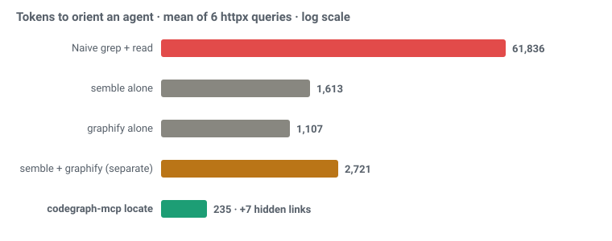
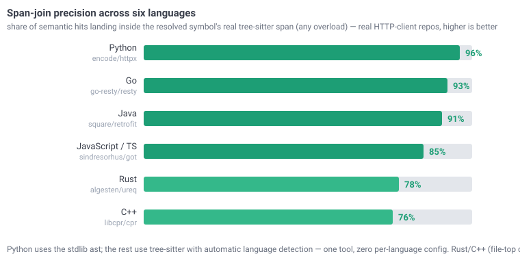

# graphlore benchmark

How many tokens and calls it takes to orient an AI coding assistant in a
codebase: `graphlore_locate` against grep + read, semble alone, Graphify alone
and the two run separately.

Back to the [README](../README.md) · [Tool reference](tools.md) ·
[Concepts](concepts.md) · [Configuration](configuration.md)

This page measures one tool, `graphlore_locate`, on six libraries. For every
tool on 31 repositories in 14 languages — what works in each language and what
does not — see the [polyglot audit](benchmark-polyglot.md).

## Results on httpx

Averaged over **6 queries** spanning httpx subsystems (send path, digest auth,
redirects, content decoding, cookies, timeouts) on the 2,101-node graph. Each query
orients an agent to a code area; *tokens* = what reaches the model's context
(≈ chars/4).

> **How tokens are counted here vs. at runtime.** The benchmark divides by 4;
> the server's own budgets and `approx_tokens` divide by 3.5 (deliberately
> conservative), or count exactly with `GRAPHLORE_TOKENIZER=tiktoken`. A runtime
> figure therefore reads about 14% higher than the same text would here. The
> ratios between approaches are unaffected, since both sides use the same
> divisor; but the grep side counts file *bytes* and the locate side reply
> *characters*, which slightly flatters grep on non-ASCII source. The numbers
> were not re-measured for this note.

| Approach | Tokens (avg) | Calls | Structure | Semantic | Hidden links |
|---|---|---|---|---|---|
| Naive grep + read | 61,836 | ~14 | — | — | 0 |
| semble alone | 1,613 | 1 | — | ✓ | 0 |
| graphify alone | 1,107 | 1 | ✓ | — | 0 |
| semble + graphify (separately) | 2,721 | 4 | ✓ | ✓ | 0 |
| **`graphlore_locate`** | **235** | **1** | ✓ | ✓ | **7** |

`graphlore_locate` averages **263× fewer tokens than grep+read** and **11.6× fewer
than running semble and graphify separately** (one call instead of four) — and it's
the only approach that surfaces hidden links (semantically similar but structurally
disconnected code), 5–10 per query.

Those ~235 tokens are a navigational *map* (seed `file:line` + structural
neighborhood + hidden links), not raw code — you fetch the specific code only where
needed. That's the trade graphlore optimizes: cheapest orientation plus the
cross-check signal, then drill in precisely. The `graphify alone` row is its own token-budgeted subgraph output — the gap to 235 is the semantic seed (landing on the right node instead of a degree-sorted expansion), not a budgeting difference.

**Case study — the hidden links are real.** Asked *"does httpx duplicate
request-sending across sync and async?"*, `graphlore_locate` returned the seed
`Client._send_single_request` and flagged hidden links. Checking the source
confirmed every production flag is a genuine sync/async twin:
`Client._send_single_request` (`_client.py:1001`) ↔ `AsyncClient._send_single_request`
(`:1717`); `BaseTransport.handle_request` ↔ `handle_async_request` (in every
transport); `__enter__` ↔ `__aenter__`. ~500 tokens (one `locate` + a targeted read)
surfaced a real architectural pattern that naively reading `_client.py` (~16k tokens)
would. The far-distance bucket also held test files (related, not refactor targets) —
the `distance` field separates production parallels (3–4) from that noise.

**Across languages — real HTTP-client repos.** The span join and freshness check aren't
Python-only. I built AST-only graphs for an HTTP client in five more languages and ran the
same kind of queries (send · redirects · timeout/retry · headers/auth · transport):

| Language | Repo | Span-join precision | Qualname | Hidden / q | locate vs grep | Calls (locate vs naive) |
|---|---|---|---|---|---|---|
| **Python** (ast) | `encode/httpx` | **96%** (52/54) | 67% | 3.2 | 272× | 1 vs 15 (0 vs 14 reads) |
| JavaScript / TS | `sindresorhus/got` | 89% (48/54) | 67% | 2.3 | 583× | 1 vs 9 (0 vs 8 reads) |
| Go | `go-resty/resty` | 93% (50/54) | 100% | 1.8 | 911× | 1 vs 17 (0 vs 16 reads) |
| Java | `square/retrofit` | 85% (46/54) | 50% | 2.3 | 217× | 1 vs 18 (0 vs 17 reads) |
| Rust | `algesten/ureq` | 70% (38/54) | 83% | 3.7 | 577× | 1 vs 22 (0 vs 21 reads) |
| C++ | `libcpr/cpr` | 72% (39/54) | 100% | 4.3 | 195× | 1 vs 16 (0 vs 15 reads) |

Python uses the stdlib `ast`; JS/TS · Go · Java · Rust · C++ go through tree-sitter with
automatic language detection — **one tool, zero per-language config**. *Span-join precision* =
share of semantic hits landing inside the resolved symbol's real span (any overload of it —
C++ collapses same-name overloads into one graph node while each keeps its own span; cpr's
`Session::SetOption` has 46). It's **70–96%** across six 350–2,095-node graphs, hidden-links
keep surfacing 2–4/query, and locate stays **195–911× cheaper** than grep+read. Orientation is
also **one tool call with zero file reads** by construction, where the grep-driven baseline
spends 9–22 calls opening 8–21 files per query — **89–95% fewer calls**, on the same grep
baseline as the token numbers. Rust and C++
trail at 70–72% — their misses are mostly file-top/whole-file chunks and namespace-level free
functions where the resolution is still correct (they recover qualified names at 83–100%).
`graphlore_freshness`'s cosmetic-vs-structural check is correct in every language too
(comment/reformat → cosmetic; operator/rename → structural). Re-measured 2026-08 on the MCP v2
SDK, Python 3.14, fresh repo HEADs. Reproduce with
[`benchmarks/multilang.py`](../benchmarks/multilang.py) (`--json` persists a run;
[`benchmarks/results-multilang.json`](../benchmarks/results-multilang.json) is the committed
record of the call/token baseline — its span-join counts predate the overload-family
re-count above).

→ **[Full benchmark report](https://htmlpreview.github.io/?https://github.com/yasinyaman/graphlore/blob/master/docs/benchmark.html)** (interactive HTML, per-query breakdown + the cross-language tables) — or open [`docs/benchmark.html`](benchmark.html) locally. ([Türkçe](https://htmlpreview.github.io/?https://github.com/yasinyaman/graphlore/blob/master/docs/benchmark.tr.html))

httpx headline measured 2026-06 with semble 0.3.4 (6 queries, per-query locate 189–286
tokens); cross-language table re-measured 2026-08 with semble 0.5.5 + the tree-sitter span
backend — 6 queries × 54 hits each on `httpx` / `got` / `resty` / `retrofit` / `ureq` / `cpr`,
call counts from the same run. **Sample bias:** every repo benchmarked here is
an HTTP-client library — a deliberately uniform family chosen for cross-language comparability.
Token savings and span-join precision will differ on other architectures (data pipelines, GUI
apps, sprawling monorepos), so treat these as indicative, not guarantees. Numbers vary by
codebase and query.

## One call beats running semble and graphify separately

semble finds **what's relevant**; graphify gives **how it connects**. They're complementary — but stitching them by hand means four calls, ~2.7k tokens, and manually aligning semble's line ranges to graph nodes. graphlore does that join *for* you, in one call:

| _per query_ | semble alone | graphify alone | both, by hand | **`graphlore_locate`** |
|---|:-:|:-:|:-:|:-:|
| Semantic search | ✓ | — | ✓ | ✓ |
| Graph structure | — | ✓ | ✓ | ✓ |
| Chunk → symbol join | — | — | _you wire it_ | **✓ automatic** |
| Hidden-links cross-check | — | — | — | **✓ only here** |
| Calls | 1 | 1 | **4** | **1** |
| Tokens to orient | 1,613 | 1,107 | 2,721 | **235** |

→ **11.6× fewer tokens than running the two separately — in a single call**, and hidden links (semantically similar code that is *structurally disconnected*) is a signal *neither tool produces alone*. So the combined tool isn't just convenience: it's cheaper, and it surfaces something the parts can't.
